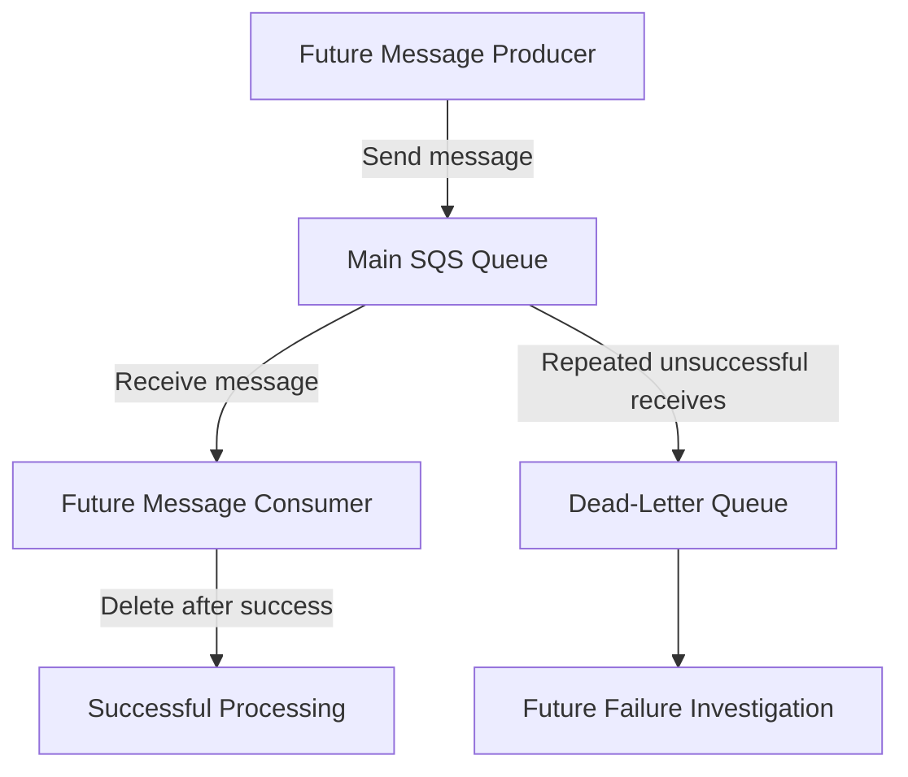
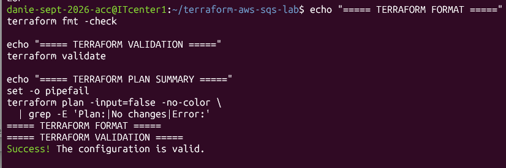

# AWS SQS Terraform Lab

## Project Overview

This project demonstrates how to design Amazon Simple
Queue Service (SQS) infrastructure using Terraform.

The configuration defines a standard message queue
and a dead-letter queue (DLQ) for messages that
repeatedly fail processing.

**Deployment status: PLANNED ONLY — NOT DEPLOYED**

## Architecture



The producer, consumer, and investigation process
are conceptual components.

No applications have been deployed.

## Planned AWS Resources

| Resource | Count |
|---|---:|
| Standard SQS queue | 1 |
| Dead-letter queue | 1 |
| **Total** | **2** |

## Technical Configuration

- AWS Region: us-east-1
- Main queue: terraform-sqs-lab-main
- Dead-letter queue: terraform-sqs-lab-dlq
- Queue type: Standard
- Main message retention: 4 days
- DLQ message retention: 14 days
- Main visibility timeout: 30 seconds
- Main long polling: 10 seconds
- Main message delay: 0 seconds
- Maximum main message size: 262144 bytes
- Dead-letter threshold: 5 receives
- Encryption: SQS-managed server-side encryption

## Security Design

Both queues use SQS-managed encryption at rest.

The main queue uses a redrive policy that
references the dead-letter queue ARN.

The dead-letter queue retains failed messages
for later investigation.

## Security and Operational Limitations

- No SQS queues have been deployed.
- No application producer or consumer exists.
- No messages have been sent or received.
- No end-to-end DLQ behavior has been tested.
- No custom IAM access policy is configured.
- No CloudWatch alarms are configured.
- No production workload testing has been performed.

Standard SQS queues provide at-least-once delivery.
Consumers should be designed to handle duplicate
messages safely.

## Tools

- Ubuntu Linux (WSL2)
- AWS CLI
- Terraform
- Git and GitHub

## Terraform Validation

Commands:

```bash
terraform fmt -check
terraform validate
terraform plan -input=false -no-color
```

Verified results:

- Terraform formatting passed.
- Terraform validation passed.
- Plan: 2 to add, 0 to change, 0 to destroy.

See [Validation Evidence](docs/validation-evidence.md).

## Deployment Status

No terraform apply has been executed.

Both SQS queues remain planned resources only.

## Cost Considerations

Amazon SQS charges may apply for queue requests
and related usage after deployment.

Review current AWS pricing before deployment.

## Future Improvements

- Deploy queues in an approved environment.
- Create a producer application.
- Create a consumer application.
- Test message delivery and deletion.
- Test dead-letter queue redrive behavior.
- Add least-privilege IAM permissions.
- Add CloudWatch alarms.
- Configure operational monitoring.

## Actual Validation Screenshot


