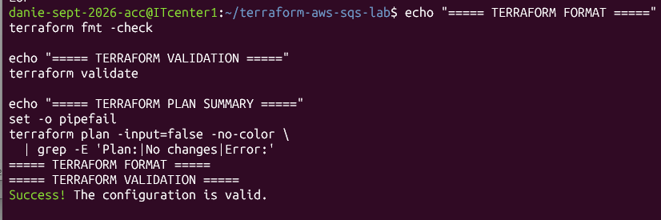

# Amazon SQS Terraform Validation Evidence

## Project Status

PLANNED ONLY — NOT DEPLOYED

## Environment

- Ubuntu Linux (WSL2)
- AWS Region: us-east-1
- Terraform v1.17.0
- AWS CLI

## Verified Terraform Results

### Formatting

Command:

terraform fmt -check

Result:

Passed.

### Validation

Command:

terraform validate

Result:

Success! The configuration is valid.

### Infrastructure Plan

Command:

terraform plan -input=false -no-color

Result:

Plan: 2 to add, 0 to change, 0 to destroy.

## Planned AWS Resources

1. aws_sqs_queue.main
2. aws_sqs_queue.dead_letter

## Planned Security Configuration

- SQS-managed server-side encryption
- Main queue visibility timeout: 30 seconds
- Main queue retention: 4 days
- DLQ retention: 14 days
- Redrive policy threshold: 5 receives

## Deployment Limitations

- No terraform apply executed
- No SQS queues deployed through this project
- No live messages processed
- No DLQ behavior tested
- No producer or consumer deployed

## Actual Validation Screenshot

